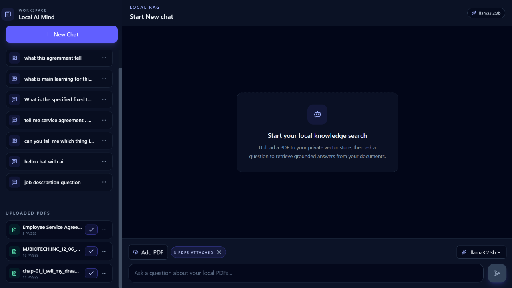
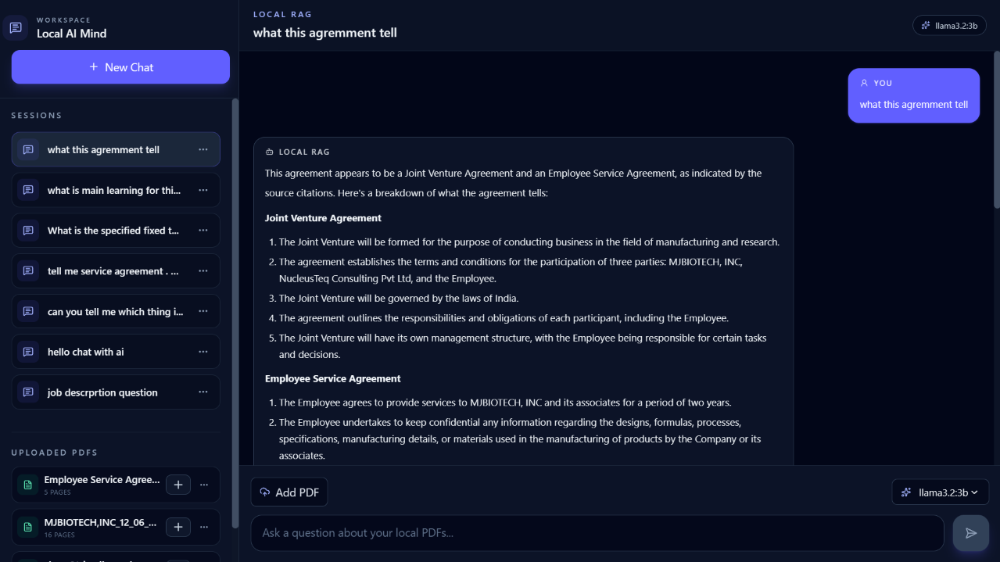

# Local AI Mind — Private, Local-First RAG Assistant
<p align="center">
  
  
  
  
  
  
  
</p>

A full-stack AI application that turns local PDF documents into a searchable knowledge base and lets users ask questions through a conversational interface. Built with **FastAPI, React, ChromaDB, SQLite, and Ollama**, the system performs document processing, semantic retrieval, and LLM inference locally—without sending document content to a hosted AI service.

> **Portfolio focus:** This project demonstrates practical skills in full-stack development, backend API design, Retrieval-Augmented Generation (RAG), vector search, local LLM integration, data persistence, and frontend state management.

---

## At a glance

| Area | Implementation |
|---|---|
| Application | Local document Q&A assistant |
| Backend | Python, FastAPI, SQLAlchemy, Pydantic |
| Frontend | React, Vite, Zustand, Tailwind CSS |
| RAG / retrieval | ChromaDB and locally generated embeddings |
| LLM runtime | Ollama |
| Persistence | SQLite for application data; ChromaDB for vector data |
| Document processing | PDF text extraction with `pdfplumber` / `pdfminer` |

## Why I built it

Working with information spread across PDF documents can make it difficult to find specific answers quickly. Local AI Mind addresses this by combining document ingestion, semantic search, and LLM-generated responses in one application.

The design emphasizes:

- **Privacy:** documents, embeddings, and model inference remain on the local machine.
- **Grounded responses:** retrieved document passages are supplied to the LLM as context.
- **Usable conversations:** users can organize questions into separate sessions and revisit previous messages.
- **Modular engineering:** API routes, application services, RAG logic, persistence, and UI state are separated into focused modules.

## Application preview

<div align="center">
  
  <p><em>Chat dashboard — ready for a document-based conversation.</em></p>
</div>

<div align="center">
  
  <p><em>Chat dashboard — answering questions using uploaded PDF content.</em></p>
</div>

## Core capabilities

### 1. PDF ingestion and semantic retrieval

- Upload PDF documents through the frontend.
- Extract text and split it into smaller chunks.
- Generate embeddings locally through Ollama.
- Store document vectors in ChromaDB.
- Retrieve relevant passages when a user submits a question.
- Use retrieved context to generate document-grounded answers.

### 2. Local LLM and embedding integration

- Connect to an Ollama instance running on the local machine.
- Configure the chat and embedding models.
- Default models:
  - Chat: `llama3.2:3b`
  - Embeddings: `nomic-embed-text`

### 3. Multi-session conversations

- Create and manage separate chat sessions.
- Persist user and assistant messages.
- Reopen previous conversation history.
- Rename or delete sessions from the interface.
- Attach or detach uploaded PDFs from the active conversation.

### 4. Full-stack chat dashboard

- React-based chat interface built with Vite.
- Sidebar for sessions, model information, and uploaded documents.
- Markdown rendering for assistant responses.
- Toast notifications for user actions and backend availability.
- Zustand-based frontend state management.

### 5. Local persistence

- SQLite stores document metadata, session records, messages, and related application metadata.
- ChromaDB stores vector embeddings used for semantic retrieval.
- Local files and indexes are organized under the project's `data/` directory.

---

## How it works

The application follows a document-ingestion pipeline and a retrieval-and-generation pipeline.

### Document ingestion

```text
PDF upload
    |
    v
FastAPI upload endpoint
    |
    v
Store PDF locally
    |
    v
Extract and chunk text
    |
    v
Generate embeddings through Ollama
    |
    v
Store vectors in ChromaDB
    |
    v
Persist document metadata in SQLite
```

### Question answering

```text
User asks a question
    |
    v
React frontend sends request to FastAPI
    |
    v
Retrieve relevant chunks from ChromaDB
    |
    v
Build context-aware prompt
    |
    v
Ollama generates an answer using retrieved context
    |
    v
Persist conversation messages in SQLite
    |
    v
Display answer in the chat interface
```

### Conversation handling

Each conversation is associated with a session ID. The frontend uses the selected session to load its message history and continue the conversation. This keeps separate conversations organized and supports follow-up questions.

---

## Architecture and code organization

The codebase separates HTTP handling, application services, reusable AI logic, and persistence.

```text
LocalAIMind_Private_RAG/
├── backend/
│   ├── config.py
│   ├── database.py
│   ├── dependencies.py
│   ├── main.py
│   ├── models.py
│   ├── core/
│   │   ├── document.py
│   │   ├── embeddings.py
│   │   ├── llm.py
│   │   └── rag.py
│   ├── routers/
│   │   ├── health.py
│   │   ├── models.py
│   │   ├── pdfs.py
│   │   └── query.py
│   └── services/
│       ├── pdf_service.py
│       └── rag_service.py
├── frontend/
│   ├── src/
│   │   ├── api/
│   │   ├── components/
│   │   ├── pages/
│   │   └── store/
│   ├── package.json
│   └── vite.config.js
├── data/
│   ├── pdf/
│   ├── pdfs/
│   ├── text/
│   └── vectors/
├── notebooks/
│   ├── local_rag.ipynb
│   └── ollama.ipynb
├── requirements.txt
└── README.md
```

### Backend responsibilities

| Module | Responsibility |
|---|---|
| `routers/` | Defines HTTP endpoints and request handling |
| `services/` | Coordinates PDF processing and RAG application workflows |
| `core/` | Contains document, embedding, LLM, and retrieval logic |
| `database.py` / `models.py` | Database setup and persistence models |
| `config.py` | Centralizes paths, model settings, and service configuration |

### Frontend responsibilities

- `api/` — communicates with the backend.
- `components/` — reusable interface elements.
- `pages/` — page-level UI.
- `store/` — shared application and conversation state managed with Zustand.

---

## API overview

The backend exposes versioned endpoints under `/api/v1`.

| Method | Endpoint | Purpose |
|---|---|---|
| `GET` | `/api/v1/health` | Check backend health |
| `GET` | `/api/v1/models` | List available Ollama models |
| `GET` | `/api/v1/pdfs` | List uploaded PDFs |
| `POST` | `/api/v1/pdfs/upload` | Upload and process a PDF |
| `DELETE` | `/api/v1/pdfs/{pdf_id}` | Delete a document |
| `POST` | `/api/v1/query` | Submit a question to the RAG pipeline |
| `GET` | `/api/v1/sessions` | Retrieve all saved chat sessions |
| `GET` | `/api/v1/session/{session_id}/messages` | Retrieve messages for a session |
| `PUT` | `/api/v1/session/{session_id}` | Rename an existing chat session |
| `DELETE` | `/api/v1/session/{session_id}` | Delete a session and its messages |

Interactive API documentation is available through FastAPI's Swagger UI at `/docs` when the backend is running.

---

## Technology stack

**Backend**
- Python 3.10+
- FastAPI
- SQLAlchemy
- Pydantic
- SQLite
- ChromaDB
- Ollama
- `pdfplumber` / `pdfminer`

**Frontend**
- React
- Vite
- Zustand
- Axios
- Tailwind CSS
- Lucide React
- Sonner
- React Markdown

---

## Run locally

### Prerequisites

- Python 3.10+
- Node.js 18+
- npm
- [Ollama](https://ollama.com/) installed and running

### 1. Install backend dependencies

From the repository root:

```bash
pip install -r requirements.txt
```

### 2. Install frontend dependencies

```bash
cd frontend
npm install
```

### 3. Start Ollama and download the models

In a separate terminal:

```bash
ollama serve
```

Download the default chat and embedding models:

```bash
ollama pull llama3.2:3b
ollama pull nomic-embed-text
```

If you use different models, update the configuration in `backend/config.py` or provide the supported environment variables.

### 4. Start the backend

From the repository root:

```bash
uvicorn backend.main:app --reload
```

Backend: `http://localhost:8000`  
API documentation: `http://localhost:8000/docs`

### 5. Start the frontend

In another terminal:

```bash
cd frontend
npm run dev
```

Frontend: `http://localhost:5173`

### 6. Try the application

1. Confirm that Ollama is running and the required models are available.
2. Open the frontend in your browser.
3. Upload one or more PDF documents.
4. Start a chat session.
5. Ask a question about the uploaded content.
6. Continue the conversation or revisit it through the session history.

---

## Configuration and data

The primary configuration file is `backend/config.py`. It controls the project paths, PDF storage location, vector database location, SQLite connection, Ollama host, and default model names.

By default, application data is stored locally:

| Data | Storage |
|---|---|
| Uploaded PDF files | Configured local PDF upload directory under `data/` |
| Vector embeddings | `data/vectors/` |
| Application metadata and chat history | SQLite database (`sqlite:///./data/localaimind.db` by default) |

This local setup avoids requiring a hosted vector database or hosted LLM API for the documented workflow.

---

## Skills demonstrated

This project provides practical examples of:

- **Full-stack development:** building a React frontend backed by a Python API.
- **Backend engineering:** designing FastAPI routes and separating routing, service, and core logic.
- **Applied AI engineering:** implementing a RAG workflow with document chunking, embeddings, vector retrieval, and LLM generation.
- **Local model integration:** connecting an application to Ollama for embeddings and inference.
- **Data management:** persisting structured application data in SQLite and semantic vectors in ChromaDB.
- **Frontend state management:** coordinating sessions, messages, documents, and UI state with Zustand.
- **API integration:** connecting frontend workflows to backend endpoints and handling application states.

## Future improvements

Potential next steps include:

- Add document-level and chunk-level source citations in responses.
- Improve document search, filtering, and metadata previews.
- Add document summarization.
- Support multiple knowledge collections or folder-based organization.
- Add conversation and index export/import.
- Introduce optional authentication for multi-user deployments.

These are planned enhancements, not capabilities claimed as currently implemented.

---

## Troubleshooting

**Backend does not start**
- Install dependencies with `pip install -r requirements.txt`.
- Check that the active Python version is compatible.
- Run Uvicorn from the repository root.

**Ollama is not responding**
- Start the Ollama service with `ollama serve`.
- Confirm that the required models have been downloaded.
- Check the configured `OLLAMA_HOST` value.

**Frontend cannot reach the backend**
- Confirm that the backend is running at `http://localhost:8000`.
- Check the Vite proxy or API base URL configuration.
- Verify the backend CORS configuration.

**PDFs or sessions are not appearing**
- Check that the configured SQLite database and local data directories exist.
- Confirm that the database schema is initialized.
- Review backend logs for database, file-processing, or vector-store errors.

---

## Project summary

Local AI Mind brings together document processing, semantic retrieval, local LLM inference, persistent conversations, and a web-based chat interface. It is a practical demonstration of how modern AI capabilities can be integrated into a full-stack application while keeping the document and inference workflow local.

**For reviewers:** start with the application screenshots, then explore the RAG flow, backend module structure, and API overview. The setup instructions provide a path to run the project locally.
